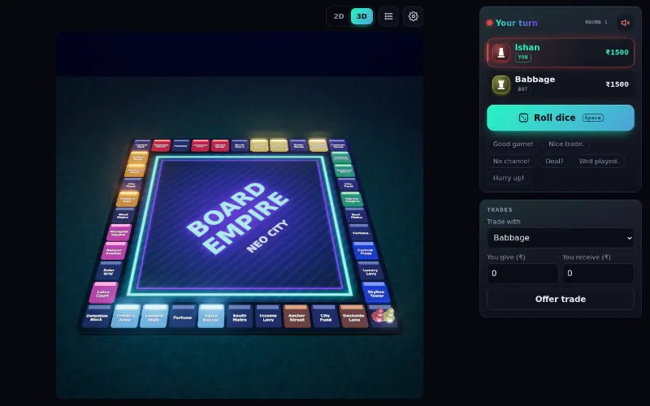
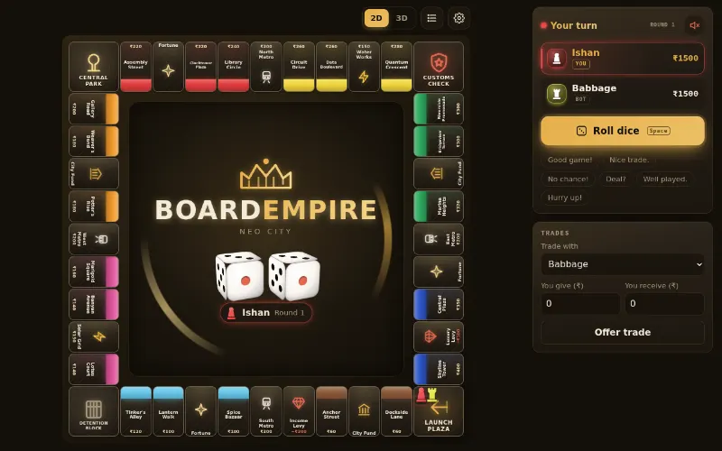
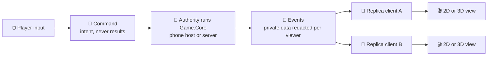
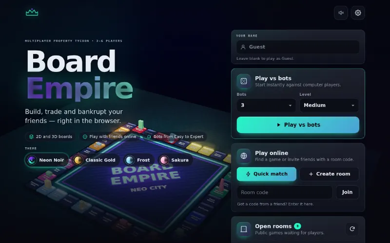
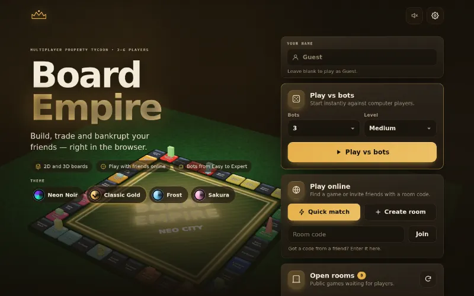
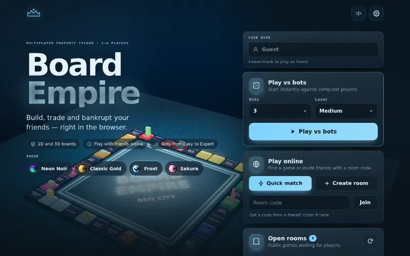
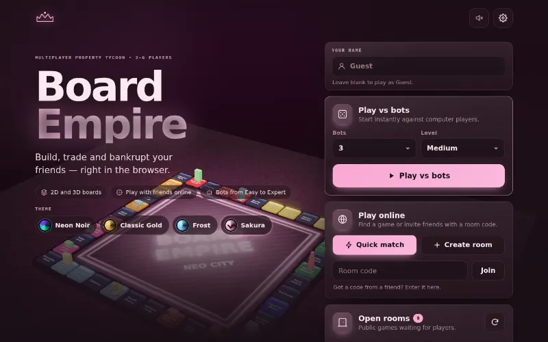

# 🎲 BoardEmpire


An original multiplayer property-trading and economy board game. One deterministic rules engine drives a 2D board and a 3D "living city" over the same event stream. Play solo, pass-and-play, over LAN or Nearby, or online, with bots, replays and composable rule modules. It runs in the browser, on Android and on the desktop.

<p align="center">
  
  
</p>

---

## ✨ Features

| | Feature |
|---|---|
| 🎯 | **One rules engine.** Deterministic C# core with auctions, trades, debt, bankruptcy, jail and cards. Same seed, same game. |
| 🧩 | **Rule modules and presets.** Classic, Classic+ (sealed auctions, secret objectives), Quick, Blitz, Market Mayhem (economy cycle, city events, public projects), Tycoon (property shares, contracts, development types, abilities), Team Empire, and custom presets from the rules editor. Presets are configurations, never code forks. |
| 🏙️ | **2D and 3D views** of the same match. The choice is a local setting, and views only animate. |
| 🌐 | **Play anywhere.** Browser (Blazor WebAssembly with three.js), Android and desktop (Godot), with solo, pass-and-play, LAN, Nearby and online modes. |
| 🤖 | **Bots** at Easy, Medium, Hard and Expert (Monte Carlo) levels. |
| 🗺️ | **Boards as JSON.** Four built-in boards (Neo City, Mars Colony, Pirate Isles, Pocket City) in the same format that custom boards use. |
| 🎨 | **Four web themes:** Neon Noir, Classic Gold, Frost and Sakura. Adding one is a single JSON file. |
| 🔁 | **Replays** you can record, watch and read as a story. |
| 🏆 | **Online services.** Accounts, rooms, matchmaking, ranked Elo, friends, invites and match recovery, backed by PostgreSQL and Redis. |
| ♿ | **Motion and accessibility.** Honors the OS reduced-motion setting in 2D and 3D, with keyboard shortcuts on the web (Space roll, B buy, E end turn, M mute). |

---

## 🗺️ How it fits together



- Clients send intent ("roll"), never results. The authority validates and answers with events.
- Events carry everything needed to change state, so the authority and every client run the same reducer. A SHA-256 of the public state is compared after each batch, and a mismatch or gap triggers an automatic resync.
- Private data (the dice stream, sealed bids, secret objectives) is redacted per viewer before it leaves the authority and is excluded from the hash.

```
src/Game.Core       rules engine, bots, replays (no engine or network dependencies)
src/Game.Protocol   versioned wire messages and packet codec
src/Game.Net        room authority, replica client, transports (loopback, LAN, WebSocket)
src/Game.Server     ASP.NET Core match server (accounts, rooms, matchmaking, persistence)
src/Game.WebClient  shared, testable client logic (session, event pacing, sound cues, themes)
src/Game.Web        Blazor WebAssembly app: pages, HUD, 2D board, 3D scene (three.js), audio
client/             Godot project: UI, 2D view, 3D view, audio, session management
android/            Kotlin plugin for Google Nearby Connections
tools/              Simulator (balance, bot tournament, replays), web-smoke checks, build scripts
tests/              Core, Net, Server, Web (C#) and JavaScript unit tests
deploy/, compose.yaml   container image and the server + Postgres + Redis stack
boards/             the built-in boards as JSON
```

---

## 🧪 Build, test, run

```bash
# .NET 8 SDK (the Android export additionally needs .NET 9)
dotnet test BoardEmpire.sln

dotnet run --project tools/Simulator -c Release -- --games 10000 --players 4
dotnet run --project tools/Simulator -c Release -- tournament --games 400
dotnet run --project tools/Simulator -c Release -- record --out match.json --preset tycoon
dotnet run --project tools/Simulator -c Release -- replay match.json --story
```

Tests against real PostgreSQL and Redis run when these are set:

```bash
BOARDEMPIRE_TEST_POSTGRES="Host=127.0.0.1;Port=55432;Username=postgres;Password=...;Database=boardempire"
BOARDEMPIRE_TEST_REDIS="127.0.0.1:56379"
```

### 🌐 Web client

The web client is Blazor WebAssembly with a version-pinned, vendored three.js. If WebGL fails it falls back to 2D, and quality tiers (Auto, High, Low) adapt to the device.

```bash
dotnet publish src/Game.Web -c Release -o out    # static site in out/wwwroot
node tools/web-smoke/run-all.mjs                  # JS unit tests, render, smoke and end-to-end checks
```

The browser checks need a Chromium build, and `run-all.mjs` starts and stops the server and proxy itself. See [tools/web-smoke/README.md](tools/web-smoke/README.md). `tools/deploy-web.sh` publishes a build to a web root.

### 🎮 Godot client

Use the Godot 4.7.2 .NET editor binary as `godot`:

```bash
cd client
godot --headless --import            # first time
godot                                # run
godot -- --demo classic --view 3d    # watch four bots play
```

Developer flags after `--` (see `client/src/DevAutomation.cs`): `--screen`, `--demo <preset>`, `--human --autoplay`, `--view 2d|3d`, `--speed`, `--shot file.png --after N`, `--host-lan`, `--join-lan host:port` and `--online-quick <url>`. On a machine without a display: `xvfb-run -a godot --rendering-driver opengl3 --audio-driver Dummy -- --demo classic --shot out.png`.

### 🤖 Android

```bash
cd client
godot --headless --export-debug "Android" build/BoardEmpire-debug.apk      # works on ARM64 hosts
```

Release builds go through `tools/build-android.sh`, which signs with the one permanent key and checks the result against `deploy/android-signing-sha256.txt`. Bump the version with `tools/set-version.sh X.Y.Z` before each release so Android accepts the update. The `Android (Gradle)` preset also bundles the Nearby plugin. It needs an x86-64 machine for the Android build tools and is what `.github/workflows/android.yml` runs on release tags.

### 🖥️ Server

```bash
cp deploy/.env.example .env      # fill in the two secrets
podman compose up -d             # server on 127.0.0.1:8091, Postgres and Redis internal
curl http://127.0.0.1:8091/healthz
```

Put a reverse proxy in front ([deploy/Caddyfile.snippet](deploy/Caddyfile.snippet)) and point the client's server URL at it. Without `BoardEmpire__Postgres` and `BoardEmpire__Redis` the server runs in memory.

---

## 🎨 Themes

<p align="center">
  
  
  
  
</p>

The web client also has a first-class phone layout, with a peek strip and a landscape rail.

---

## ⚠️ Known limits

See [HANDOFF.md](HANDOFF.md) for what has and hasn't been verified (device testing, the Nearby plugin and real-network behavior) and what is intentionally left out.

Fonts: Space Mono, Outfit and Noto Sans Devanagari (SIL Open Font License, texts in `client/assets/fonts`).
